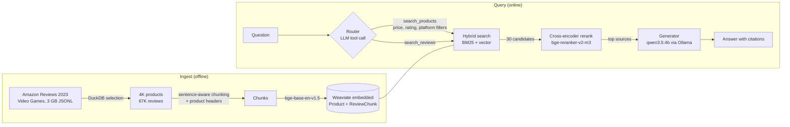

# review-rag-assistant

A retrieval-augmented shopping assistant for video game products. Ask it "which wireless headsets under $60 do people like?" or "do DualSense controllers drift?" and it answers from 4,000 Amazon product listings and 66K customer reviews, citing the listing or review behind every claim.

It runs entirely on a laptop GPU (RTX 2070, 8 GB) with open-source models. Claude is optional, used as an eval judge and as a comparison point.

> Status: in active development. The ingestion, retrieval, generation, and eval pipelines work from the CLI. The web UI and the results tables below are in progress.

## Architecture



## How it works

**Selection (DuckDB).** The raw Video Games category has 137K products and 4.6M reviews. A DuckDB query reads the JSONL directly and keeps priced products with at least 50 ratings, the top 4,000 by rating count, and up to 20 reviews per product, preferring verified and helpful ones. It drops gift cards and misfiled items (books and DVDs in the games category), strips HTML from review text, and hashes stable review IDs. The step takes about 3 seconds and logs row counts at each stage.

**Chunking.** Most reviews fit in one chunk. Longer ones split on sentence boundaries at about 300 tokens with a small overlap. Every chunk gets a header naming the product, its category, and the star rating. Without it, a review that says "the battery dies in two hours" can't be matched to a search for "Xbox controller battery life".

**Two-stage retrieval.** Weaviate runs a hybrid search (BM25 for exact terms like model numbers, vectors for meaning like "comfortable for long sessions") with metadata filters, and returns 30 candidates. A cross-encoder then reads each question and candidate together and reorders them. The reranker is too slow to run on the whole corpus but works well on a shortlist.

**Routing.** The LLM turns the question into typed tool calls instead of SQL: `search_products(query, max_price, min_average_rating, platform, product_type, sort_by)` and `search_reviews(query, ...)`. A 4B model fills in arguments reliably but writes SQL poorly, and typed tools can't run arbitrary queries. If routing fails, the question goes straight to review search.

**Grounded generation.** The generator sees numbered sources and must cite them, say when the sources don't answer the question, and report the balance of reviewer opinion instead of treating one review as fact.

## Evaluation

The golden set (`eval/golden.jsonl`) has questions of five types: specific review facts, product opinions, filtered product searches, comparisons, and unanswerable questions (products that don't exist in the 2023 data). An LLM drafted candidates from sampled reviews, and a human reviewed and edited them. Each question records which reviews and products answer it.

- **Retrieval** (`uv run rra eval-retrieval`, no LLM calls): hit@5, hit@10, and MRR for BM25, vector, hybrid, and hybrid+rerank. Strict scoring counts only the exact source review; lenient scoring accepts any source from the right product.
- **Generation** (`uv run rra eval-generation`): runs the full pipeline. Free automatic checks cover invalid citation numbers, uncited answers, and price-constraint violations. A Claude judge scores faithfulness, correctness, and citation quality against the exact sources the generator saw, and checks whether unanswerable questions get an abstention.

### Retrieval results (preliminary)

These numbers come from 53 LLM-drafted candidate questions that haven't been human-reviewed yet. They'll be rerun on the reviewed set. Strict scores use the 33 questions tied to a specific review. Lenient scores use 40 questions (product searches are excluded because they depend on the router's filters and sorting and have many valid answers; the generation eval covers them).

| First stage | Rerank | Strict hit@5 | Strict hit@10 | Strict MRR | Lenient hit@5 | Lenient MRR | p50 latency |
|---|---|---|---|---|---|---|---|
| BM25 | no | 0.52 | 0.70 | 0.42 | 0.85 | 0.73 | 3 ms |
| Vector | no | 0.61 | 0.67 | 0.43 | 0.97 | 0.90 | 12 ms |
| Hybrid | no | 0.67 | 0.73 | 0.48 | 0.95 | 0.86 | 15 ms |
| Hybrid | yes | 0.67 | **0.85** | **0.52** | 0.90 | 0.86 | 364 ms |

What this shows so far:
- Hybrid beats BM25 and vector alone at finding the exact supporting review (strict hit@5 0.67 vs 0.52 and 0.61).
- Reranking moves the exact review up the list (strict MRR 0.48 to 0.52, hit@10 0.73 to 0.85), at a cost of about 350 ms on an RTX 2070.
- Vector search alone is best at finding *some* review of the right product (lenient hit@5 0.97). The reranker sometimes promotes a very on-topic review of a different product. With only 40 questions, that gap is within noise, and the reviewed set will show whether it holds.

Generation results are in progress.

## Running it

Requirements: Python 3.12, [uv](https://docs.astral.sh/uv/), [Ollama](https://ollama.com), and an NVIDIA GPU (CPU works but is slow). No Docker: Weaviate runs in embedded mode.

```bash
uv sync
ollama pull qwen3.5:4b

# Download the raw data (~3 GB, not committed)
mkdir -p data/raw
B=https://huggingface.co/datasets/McAuley-Lab/Amazon-Reviews-2023/resolve/main/raw
curl -L -o data/raw/meta_Video_Games.jsonl $B/meta_categories/meta_Video_Games.jsonl
curl -L -o data/raw/Video_Games.jsonl $B/review_categories/Video_Games.jsonl

uv run rra select            # DuckDB selection -> data/processed/*.parquet
uv run rra index --recreate  # chunk, embed, load into Weaviate
uv run rra ask "Do people report stick drift on the DualSense controller?"
```

Copy `.env.example` to `.env` and add `ANTHROPIC_API_KEY` to use the Claude judge or Claude as the generator (`-g anthropic:claude-sonnet-5-5`).

## Known limitations

- **The data ends in 2023.** Amazon Reviews 2023 is the newest public release. The assistant knows nothing about later products, and the golden set tests that it says so.
- **Amazon's category labels are sometimes wrong**, e.g. a Switch LAN adapter tagged as Wii U or a PS5 racing wheel tagged as PlayStation 3. Platform filters inherit those errors.
- **The corpus is a sample.** It covers 20 reviews for each of 4,000 products, so opinion summaries describe that sample, not every review on Amazon.

## Data

[Amazon Reviews 2023](https://amazon-reviews-2023.github.io/) (Hou et al., 2024, McAuley Lab, UCSD). The dataset is released for research use without a formal license. This repo contains code only and no review text.

## Background

This project modernizes the stack from the 2023 [Full Stack LLM Bootcamp](https://fullstackdeeplearning.com/llm-bootcamp/) (askFSDL: sourced Q&A, LangChain, vector search) with what has become standard since: hybrid search and reranking, typed tool calls instead of agent loops, local open-weight models, and evals as a first-class part of the project.
