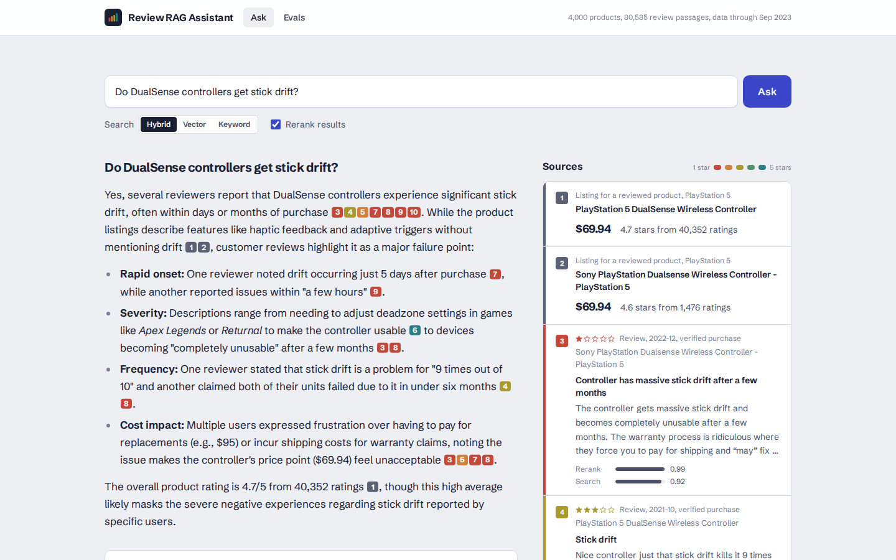
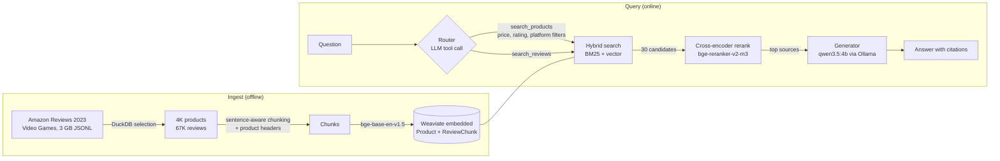

# review-rag-assistant

A shopping assistant for video game products, built on retrieval-augmented generation. Ask it "which wireless headsets under $60 do people like?" or "do DualSense controllers drift?" and it answers from 4,000 Amazon product listings and 67K customer reviews. Every claim cites the listing or review it came from.

It runs on a consumer GPU (an RTX 2070 with 8 GB) using open-weight models. Claude is optional. I use it as the eval judge and as a point of comparison.

> Status: in active development. Ingestion, retrieval, generation, the web UI, and the retrieval and router evals all work. Judged generation results are next.



The color of each citation is the star rating of the review behind it, so you can see whether a claim rests on 1-star complaints or 5-star praise. The panel under the answer shows what the router searched for, with which filters, and where the time went.

## Architecture



## How it works

**Selection.** The raw Video Games category has 137K products and 4.6M reviews. A DuckDB query reads the JSONL files directly. It keeps priced products with at least 50 ratings, takes the top 4,000 by rating count, and keeps up to 20 reviews per product, verified and most helpful first. It also drops gift cards, drops misfiled items such as books and DVDs, strips HTML from review text, and hashes a stable ID for each review. The whole step takes about 3 seconds and logs the row count after each filter.

**Chunking.** Most reviews fit in one chunk. Longer ones split on sentence boundaries at about 300 tokens, with a small overlap. Every chunk starts with a header naming the product, its category, and the star rating. A review that says "the battery dies in two hours" never names the product, and without the header a search for "Xbox controller battery life" can't find it.

**Two-stage retrieval.** Weaviate runs a hybrid search with metadata filters and returns 30 candidates. BM25 catches exact terms like model numbers. Vectors catch meaning, like "comfortable for long sessions". A cross-encoder then reads the question and each candidate together and reorders them. It's too slow to run over 80K chunks, but on 30 candidates it adds about 350 ms.

**Routing.** The LLM turns the question into typed tool calls: `search_products(query, max_price, min_average_rating, platform, product_type, sort_by)` and `search_reviews(query, ...)`. I chose typed tools over text-to-SQL. Filling in a few arguments is an easier job for a 4B model than writing correct SQL, and typed tools can't run arbitrary queries. If routing fails, the question goes straight to review search.

**Grounded generation.** The generator sees numbered sources and has to cite them. It must say when the sources don't answer the question. Reviews retrieved for "stick drift" are all drift complaints, so the pipeline also attaches the product listing, and the prompt tells the model to report the overall rating alongside the complaints.

## Evaluation

The golden set in `eval/golden.jsonl` has five kinds of question: specific review facts, product opinions, filtered product searches, comparisons, and unanswerable questions about products that aren't in the 2023 data. Claude drafted 53 candidates from sampled reviews, and I'm reviewing and editing each one before the final runs. Each question lists the reviews and products that answer it.

- `uv run rra eval-retrieval` scores hit@5, hit@10, and MRR for BM25, vector, hybrid, and hybrid+rerank. It makes no LLM calls. Strict scoring counts only the exact review a question came from. Lenient scoring accepts any review of the right product.
- `uv run rra eval-generation` runs the full pipeline on every question. Code checks catch citation numbers that point at no source, answers with no citations, and recommended products over the stated price limit. A Claude judge scores faithfulness, correctness, and citation quality against the exact sources the generator saw, and checks that unanswerable questions get an "I don't know".

### Retrieval results (preliminary)

These come from the 53 unreviewed candidates, and I'll rerun them on the reviewed set. Strict scores use the 33 questions tied to one specific review. Lenient scores use 40 questions. I left out product searches, because raw retrieval can't apply the router's price filters and sorting, and most of those questions have many valid answers. The generation eval covers them instead.

| First stage | Rerank | Strict hit@5 | Strict hit@10 | Strict MRR | Lenient hit@5 | Lenient MRR | p50 latency |
|---|---|---|---|---|---|---|---|
| BM25 | no | 0.52 | 0.70 | 0.42 | 0.85 | 0.73 | 3 ms |
| Vector | no | 0.61 | 0.67 | 0.43 | 0.97 | 0.90 | 12 ms |
| Hybrid | no | 0.67 | 0.73 | 0.48 | 0.95 | 0.86 | 15 ms |
| Hybrid | yes | 0.67 | **0.85** | **0.52** | 0.90 | 0.86 | 364 ms |

What I take from this so far:
- Hybrid finds the exact supporting review more often than either method alone, with strict hit@5 of 0.67 against 0.52 for BM25 and 0.61 for vector.
- Reranking moves the exact review up the list. Strict MRR goes from 0.48 to 0.52 and hit@10 from 0.73 to 0.85, for about 350 ms per query on an RTX 2070.
- Vector search alone is best at finding some review of the right product, at 0.97. The reranker sometimes promotes an on-topic review of a different product. With 40 questions that gap could be noise, and the reviewed set will tell.

### Router results

`uv run rra eval-router` checks 48 questions for the expected tool and the filters the question states.

| Router model | Expected tool | Stated filters extracted | Extra filters added | Median time |
|---|---|---|---|---|
| qwen3.5:4b | 85% | 4 of 4 | 38% | 1.0 s |
| qwen3.5:9b | 83% | 4 of 4 | 27% | 1.4 s |

The first run found a real bug. The router offered 13 product types, one of them "Digital Video Games" with a single product in it, and the 4B model picked it for questions about Nioh, PS5 games, and Zelda. The filtered search returned nothing, and the answer said "the sources don't contain this" for three questions the data could answer. Two fixes: the router now only sees categories with at least 20 products, and when a platform or category filter leaves fewer than 3 results, the search retries without it. After the fixes, the share of answers with no citations dropped from 8% to 0%.

"Extra filters" overstates the problem. Most are platforms the question names, like Switch for "Switch screen protector", which the golden set doesn't list as required. Telling the 4B model to add fewer filters made no difference, so the retry fallback carries that load.

### Generation results (code checks only)

Judge scores need an API key and come next. These are the checks code can make on its own, over all 53 questions:

| Generator | Uncited answers | Invalid citations | Products within price limit | Median first word | Median full answer |
|---|---|---|---|---|---|
| qwen3.5:4b | 0% | 0% | 100% | 1.3 s | 6.9 s |
| qwen3.5:9b | 0% | 0% | 100% | 3.3 s | 12.6 s |

Reading the answers by hand turns up what the numbers miss. The 4B model correctly declines three of the five unanswerable questions. On the other two it substitutes something nearby: it describes the PS5 controller when asked about a PS6 controller, and it builds a return policy out of reviewers' offhand comments. The 9B model declines four of five, including the PS6 trap, at almost twice the latency. The judge run will put numbers on that tradeoff.

## Running it

You need Python 3.12, [uv](https://docs.astral.sh/uv/), [Ollama](https://ollama.com), and an NVIDIA GPU. CPU works, slowly. There's no Docker, because Weaviate runs in embedded mode.

```bash
uv sync
ollama pull qwen3.5:4b

# Download the raw data (~3 GB, not committed)
mkdir -p data/raw
B=https://huggingface.co/datasets/McAuley-Lab/Amazon-Reviews-2023/resolve/main/raw
curl -L -o data/raw/meta_Video_Games.jsonl $B/meta_categories/meta_Video_Games.jsonl
curl -L -o data/raw/Video_Games.jsonl $B/review_categories/Video_Games.jsonl

uv run rra select            # DuckDB selection -> data/processed/*.parquet
uv run rra index --recreate  # chunk, embed, load into Weaviate
uv run rra ask "Do people report stick drift on the DualSense controller?"
```

To run the web UI, build it once and start the server. It serves both the API and the UI at http://127.0.0.1:8000.

```bash
cd web && npm install && npm run build && cd ..
uv run rra serve
```

For front-end work, run `npm run dev` in `web/` alongside `uv run rra serve`. Vite proxies `/api` to the backend.

To use the Claude judge, or Claude as the generator with `-g anthropic:claude-sonnet-5-5`, copy `.env.example` to `.env` and add `ANTHROPIC_API_KEY`.

## Known limitations

**The data ends in 2023.** Amazon Reviews 2023 is the newest public release, so the assistant knows nothing about later products. The golden set checks that it says so.

**Amazon's category labels are sometimes wrong.** A Switch LAN adapter is tagged Wii U, and a PS5 racing wheel is tagged PlayStation 3. Platform filters inherit those mistakes.

**The corpus is a sample.** It holds 20 reviews per product, so an opinion summary describes those 20 reviews, not everything on Amazon.

## Data

[Amazon Reviews 2023](https://amazon-reviews-2023.github.io/) (Hou et al., 2024, McAuley Lab, UCSD). The lab released it for research use without a formal license. This repo contains code only, no review text.

## Background

The 2023 [Full Stack LLM Bootcamp](https://fullstackdeeplearning.com/llm-bootcamp/) built askFSDL, a Q&A bot with sources, on LangChain and vector search. This project keeps that idea and replaces the parts that have changed since:
- hybrid search plus reranking instead of vector search alone
- typed tool calls instead of open-ended agent loops
- a local open-weight model instead of a hosted API
- an eval suite that measures each of these choices
